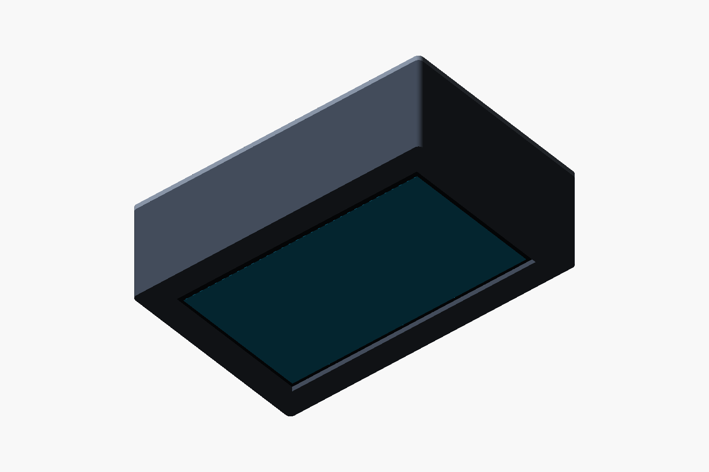
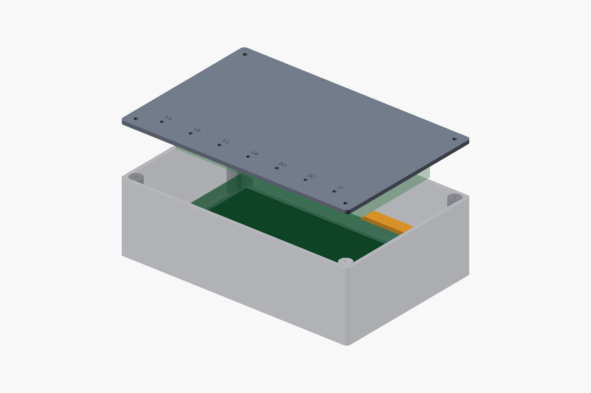

# 7B＋六接口底板：长方形试装外壳 v0.1

按用户“测试版长方形外壳，嵌入7B触屏＋六接口底板”的要求制作。采用前嵌屏幕、后方独立固定底板、四螺钉可拆后盖。**这是可以打印检查空间的结构初稿；7B尚未到货，底板及成品连接器还未定型。** 不要求先买齐探头才能做样壳。





图片中的绿色方块是空间包络，未绘制实际元器件、插头和线缆。图片不表示已有六接口PCB设计。模型前面是 `z=0`，后面是 `z=60`；从前方看，`x`向右、`y`向上。下文孔位使用装配坐标；后盖STL为平放打印绕x轴翻面，局部y方向与装配坐标相反。

## 文件和打印数量

| 文件 | 数量/用途 |
|---|---|
| [central_case.scad](central_case.scad) | 参数化源文件，用OpenSCAD打开 |
| [exports/body.stl](exports/body.stl) | 主壳1件，前面朝打印平台 |
| [exports/rear_cover.stl](exports/rear_cover.stl) | 空白后盖1件；外表面朝平台、底板柱朝上 |
| [exports/rear_cover_pilot.stl](exports/rear_cover_pilot.stl) | 带定位孔后盖，替代空白后盖，二选一 |
| [exports/retainer.stl](exports/retainer.stl) | 屏幕后固定条，打印2件 |
| [exports/geometry_report.json](exports/geometry_report.json) | STL闭合、连通、体积、尺寸及SHA256检查记录 |

单位为毫米，切片按100%比例导入。主壳＋一个后盖＋两条固定条即一套。默认结构各零件均有平面落床；先检查切片层预览及实际打印机成形范围。室温试装可先用现有材料；车内高温用途的材料及散热结构在温升验证后确定。

## 尺寸：官方参考与本次假设分开记录

官方来源：[7B相关资料/3D图纸入口](https://docs.waveshare.net/ESP32-P4-WIFI6-Touch-LCD-7B/Resources-And-Documents/)，[原始3D压缩包](https://www.waveshare.net/w/upload/9/9f/ESP32-P4-WIFI6-Touch-LCD-7B-3D.zip)。读取其中 `ESP32-P4-WIFI6-Touch-LCD-7B外形尺寸图-20251108.pdf`；原包SHA256为 `7c0fc1548cd7347c5f6c5c2727e4b83a07a5404674fc60d809638a2040b420cd`。原厂CAD不随本模型重新分发。

| 项目 | 尺寸 mm | 性质 |
|---|---|---|
| 7B玻璃外形 | 164.28±0.1 × 99.17±0.1 | 官方图纸 |
| 可视区VA | 154.58±0.2 × 86.42±0.2 | 官方图纸 |
| VA距玻璃边 | 左3.06、右6.64、上4.02、下8.73 | 官方图纸；可视区不居中 |
| PCB / 整体厚度 | 164 × 97 / 15.3 | 官方图纸；不含接线弯曲空间 |
| 屏幕安装位 | 156 × 89，4-M2.5螺纹 | 官方图纸；不是φ2.5通孔 |
| 外壳装配外形 | **190 × 125 × 60** | 本次样壳假设；可修改 |
| 主壳 / 后盖厚度 | 57深 / 3厚 | 本次样壳假设 |
| 壁厚 / 前唇厚度 | 3 / 3 | 本次样壳假设 |
| 前窗 / 玻璃定位口 | 161 × 94 / 165.28 × 100.17 | 本次样壳假设，名义单边0.5间隙 |
| 底板包络 / 暂定安装孔距 | 150 × 75 / 140 × 65 | **待设计的占位尺寸，不是现有PCB参数** |
| 底板板厚 / 前侧元件高度 / 后侧支柱 | 1.6 / 14 / 10 | 本次空间预算；连接器及天线仍需核对 |
| 固定条 | 183 × 10 × 3，2件 | 本次样壳假设；两端与侧墙各留0.5间隙 |

前窗沿玻璃中心开得比VA大，以容纳VA偏置。按默认尺寸、玻璃单边0.5位移及VA边缘额外0.3余量检查，四边仍露出VA；这不是实板显示/触摸验收。屏幕玻璃前方留名义0.5软垫位置，不能硬拧螺钉压玻璃。

底板固定在后盖内侧，元件面朝屏幕：板前表面 `z=45.4`，14高元件的前端 `z=31.4`；屏幕固定条后表面 `z=27`，名义剩余4.4间隙。**这里没有计入超出包络的USB插头、端子、SPI线束和天线净空**；最终器件布置可能要求增加 `case_d` 或修改底板位置。

## 固定、定位孔和维护

1. 后盖通过4个φ3.4孔固定到主壳φ2.6盲试孔；屏幕固定条两端同样采用M3尺寸。试孔用于塑料自攻试装，不是热熔螺母规格。先打印一处试孔确认紧固件配合，避免强行拧裂。
2. 7B通过其原有4-M2.5安装位连接两条固定条，中间加绝缘间隔柱及垫片。固定条上φ4.5调整孔用于容纳玻璃与PCB的相对位置偏差；**默认将孔阵列与玻璃中心对齐只是装配假设**，不是原图给出的玻璃相对孔坐标。到货后测量安装位高度、偏移和允许旋入深度，再选间隔柱及螺钉长度；不得拿总厚度15.3代替螺孔端面高度。
3. 底板使用独立4支柱，固定条不承受底板重量。底板安装孔/模块未定，先用纸板或绝缘空板按包络检查；修改孔距后只需重新打印后盖。
4. 定位版后盖在 `y=15`、`x=23/47/71/95/119/143/167` 各有φ3孔，依次标 `T1/T2/T3/T4/B1/B2/P`。这是四胎温、两刹车和电源的**机械占位标记**，不规定轮位映射、针脚或连接器。孔距24；成品连接器应在选型后按开孔、法兰、螺母、尾部、插拔及应力释放所需空间重排，不能直接往φ3孔插探头线束。空白后盖可保留至选型完成。
5. 首版没有精确USB/BOOT/RESET、蜂鸣器声孔或散热开孔；维护时拆后盖。7B侧向插头可能需要开侧窗，不能关盖硬折线。先进行断电试装，再按真实接口位置加工或修改模型。五个C3天线布置及温升检查属于后续底板/整机设计，不因这个样壳而视为通过。
6. 暂不添加车型底座和车用固定孔。外壳可以先放台架验证，仪表台底座与实际固定方式后续另定。

## 收到7B后的最小试装

先打印主壳检查玻璃定位口、前窗和软垫，再试两条固定条。屏幕能自然落入、VA完整露出、4-M2.5安装位对齐后，测量间隔柱及螺钉长度；无法自然对齐就调整参数，不能靠拧紧强行拉正。然后用底板占位板检查盖合、元件高度、维护插头及线束弯曲空间。六接口底板选型与电气审查推进后，再加工真正的连接器孔并验证带线盖合。

## 重新生成与检查

依赖：Python标准库、OpenSCAD 2021.01或更新版。工具不随仓库打包，也不自动下载安装。

```powershell
python hardware/wired_tire_central/enclosure/export_case.py --openscad 'C:/path/to/openscad.com'
python hardware/wired_tire_central/enclosure/export_case.py --check-only
```

修改 `central_case.scad` 开头参数后重新导出；`part` 可选 `body/rear_cover/rear_cover_pilot/retainer/assembly/exploded`。STL检查覆盖边闭合、面绕向、单一连通体、正体积及外形尺寸记录；不能证明装配干涉全部排除、切片成功或实物耐温/强度合格。

本次不改固件、引脚、BLE/RaceChrono协议和已有离线软件包，也未产生原理图、PCB、BOM或Gerber。
